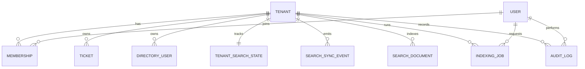

# Domain Model

Entities:

- `Tenant`
  Schema/model: `src/db/schema.ts` in `tenants`
  Primary service owner: tenant context is consumed by `src/lib/auth/session.ts` and enforced across `src/services/*`

- `User`
  Schema/model: `src/db/schema.ts` in `users`
  Primary service owner: request auth resolution in `src/lib/auth/session.ts`

- `Membership`
  Schema/model: `src/db/schema.ts` in `memberships`
  Primary service owner: `src/lib/auth/session.ts` using `findSessionMembership()` from `src/repositories/membershipRepository.ts`

- `Ticket`
  Schema/model: `src/db/schema.ts` in `tickets`
  Primary service owner: `src/services/ticketService.ts`

- `DirectoryUser`
  Schema/model: `src/db/schema.ts` in `directoryUsers`
  Primary service owner: `src/services/directoryUserService.ts`

- `SearchDocument`
  Schema/model: `src/db/schema.ts` in `searchDocuments`
  Primary service owner: `src/services/searchService.ts` for reads and `src/services/indexingJobRunner.ts` for writes

- `SearchSyncEvent`
  Schema/model: `src/db/schema.ts` in `searchSyncEvents`
  Primary service owner: `src/services/ticketService.ts` and `src/services/directoryUserService.ts` on write, then `src/services/indexingJobRunner.ts` on consume

- `TenantSearchState`
  Schema/model: `src/db/schema.ts` in `tenantSearchStates`
  Primary service owner: `src/services/searchService.ts` and `src/services/indexingService.ts`

- `IndexingJob`
  Schema/model: `src/db/schema.ts` in `indexingJobs`
  Primary service owner: `src/services/indexingService.ts` and `src/services/indexingJobRunner.ts`

- `AuditLog`
  Schema/model: `src/db/schema.ts` in `auditLogs`
  Primary service owner: `src/services/ticketService.ts`, `src/services/directoryUserService.ts`, and `src/services/indexingService.ts`

The core split to notice is source-of-truth vs read model. `Ticket` and `DirectoryUser` are the canonical write-side entities; `SearchDocument` is a denormalized, generation-aware read model built from them through `buildTicketSearchDocument()` and `buildDirectoryUserSearchDocument()` in `src/lib/search/document-builder.ts`.

## Keys and constraints that drive behaviour (`src/db/schema.ts`)

| Table | Constraint | Why it matters |
| --- | --- | --- |
| `memberships` | unique `(tenant_id, user_id)` | One role per user per tenant; `findSessionMembership()` relies on it returning at most one row. |
| `tickets` | unique `(tenant_id, external_id)` | `externalId` is `TCK-<last 6 digits of Date.now()>-<100..999>` (`src/services/ticketService.ts:33-35`). Two tickets whose creation times share the same last six millisecond digits (the same millisecond, or any multiple of 1,000 seconds apart) have a 1-in-900 chance of colliding, which surfaces as a unique-violation 500. |
| `tickets.assignee_user_id` | FK to `users.id` (global), not to `memberships` | Nothing checks that the assignee belongs to the ticket's tenant (`createTicketSchema` only checks it is a UUID, `src/lib/validation/ticketSchemas.ts:14`). |
| `search_documents` | unique `(tenant_id, entity_type, entity_id, generation)` | The `ON CONFLICT` target for every index write. It is also why a batch containing the same entity twice fails (finding T2 in `docs/architecture/README.md`). |
| `search_sync_events.id` | `bigint` identity | Used as the per-tenant cursor (`tenant_search_states.last_processed_event_id`). Identity values are *allocated* in order but transactions can *commit* out of order, which matters for the cursor (finding T7 in `docs/architecture/README.md`). |
| `tenant_search_states.tenant_id` | primary key | One state row per tenant, created lazily by `ensureTenantSearchState()` with `onConflictDoNothing()` (`src/repositories/tenantSearchStateRepository.ts:13-20`). |
| `indexing_jobs` | index on `(tenant_id, created_at)` only | No partial unique index on "one QUEUED/RUNNING incremental job per tenant", so the coalescing in `ensureQueuedIncrementalJob()` is select-then-insert and can create duplicates under concurrency. |

## What each column is used for (and what is never read)

- `search_documents.source_version` is set to `updatedAt.getTime()` (`src/lib/search/document-builder.ts:40`, `:66`) and written on every upsert, but no query compares it. It is informational.
- `search_documents.indexed_at` is set to `now()` on update (`src/repositories/searchDocumentRepository.ts:49`) and returned in search results.
- `indexing_jobs.stats` receives only `{ type, entityTypes }` on completion (`src/services/indexingJobRunner.ts:49-52`): no document counts, durations or event counts.
- `audit_logs` is written by three services, but no repository function reads it (`src/repositories/auditLogRepository.ts` exports only `createAuditLog`), so there is no audit UI or API.
- The `sync_operation` enum has `DELETE`, but nothing creates `DELETE` events, and there are no delete endpoints for tickets or directory users.

## Exercise

**Goal:** given a ticket id, predict every row that one `PATCH`-style status change writes.
**Check:** five writes in one transaction (`src/services/ticketService.ts:113-167`): `tickets` update, one `search_sync_events` insert, one `tenant_search_states` update (plus a no-op insert from `ensureTenantSearchState`), zero or one `indexing_jobs` insert (zero if an incremental job is already `QUEUED`/`RUNNING`), one `audit_logs` insert. Zero `search_documents` writes: the index changes only when a job runs.
