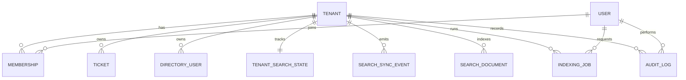

# Domain Model

Entities:

- `Tenant`
  Schema/model: `src/db/schema.ts` in `tenants`
  Primary service owner: tenant context is consumed by `src/lib/auth/session.ts` and enforced across `src/services/*`

- `User`
  Schema/model: `src/db/schema.ts` in `users`
  Primary service owner: request auth resolution in `src/lib/auth/session.ts`

- `Membership`
  Schema/model: `src/db/schema.ts` in `memberships`
  Primary service owner: `src/lib/auth/session.ts` using `findSessionMembership()` from `src/repositories/membershipRepository.ts`

- `Ticket`
  Schema/model: `src/db/schema.ts` in `tickets`
  Primary service owner: `src/services/ticketService.ts`

- `DirectoryUser`
  Schema/model: `src/db/schema.ts` in `directoryUsers`
  Primary service owner: `src/services/directoryUserService.ts`

- `SearchDocument`
  Schema/model: `src/db/schema.ts` in `searchDocuments`
  Primary service owner: `src/services/searchService.ts` for reads and `src/services/indexingJobRunner.ts` for writes

- `SearchSyncEvent`
  Schema/model: `src/db/schema.ts` in `searchSyncEvents`
  Primary service owner: `src/services/ticketService.ts` and `src/services/directoryUserService.ts` on write, then `src/services/indexingJobRunner.ts` on consume

- `TenantSearchState`
  Schema/model: `src/db/schema.ts` in `tenantSearchStates`
  Primary service owner: `src/services/searchService.ts` and `src/services/indexingService.ts`

- `IndexingJob`
  Schema/model: `src/db/schema.ts` in `indexingJobs`
  Primary service owner: `src/services/indexingService.ts` and `src/services/indexingJobRunner.ts`

- `AuditLog`
  Schema/model: `src/db/schema.ts` in `auditLogs`
  Primary service owner: `src/services/ticketService.ts`, `src/services/directoryUserService.ts`, and `src/services/indexingService.ts`

The core split to notice is source-of-truth vs read model. `Ticket` and `DirectoryUser` are the canonical write-side entities; `SearchDocument` is a denormalized, generation-aware read model built from them through `buildTicketSearchDocument()` and `buildDirectoryUserSearchDocument()` in `src/lib/search/document-builder.ts`.
